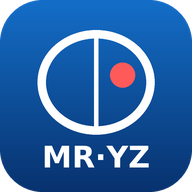
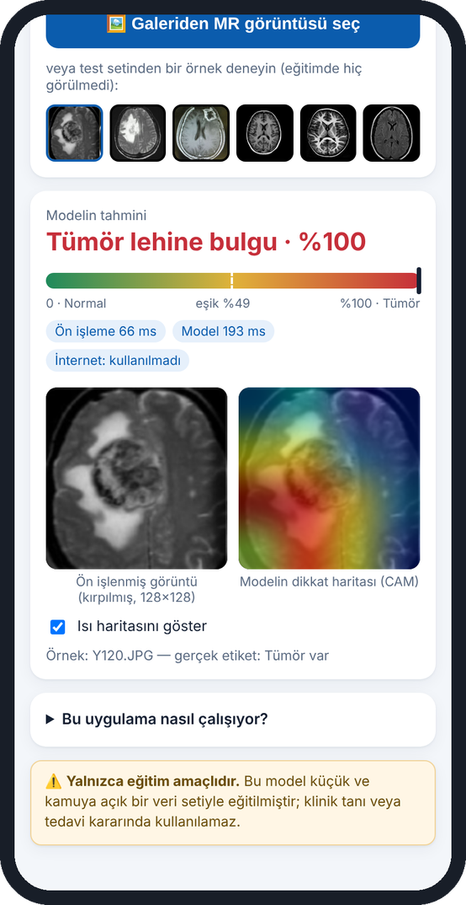
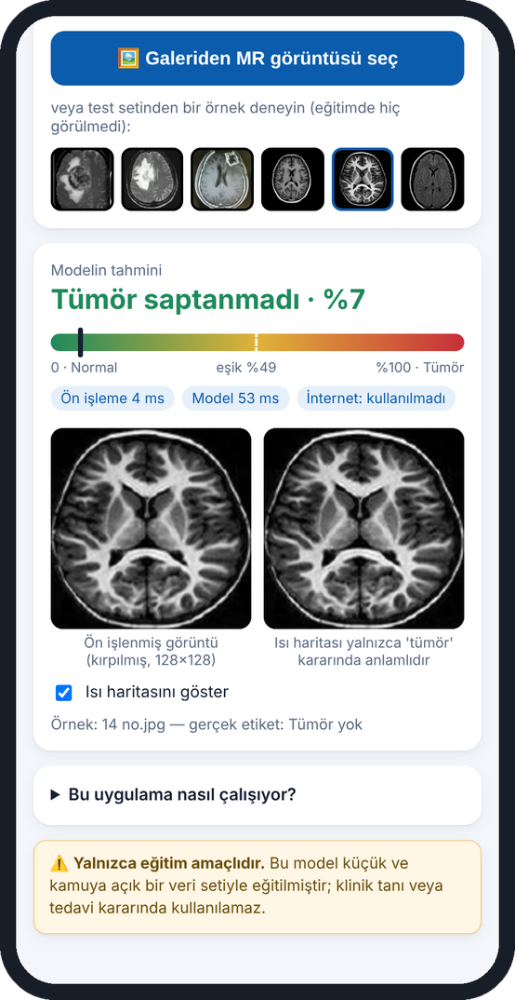
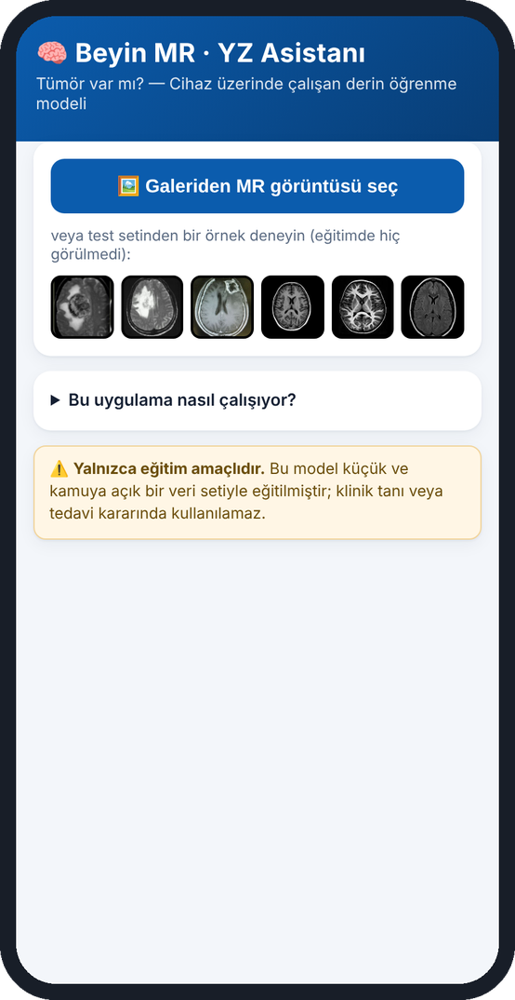
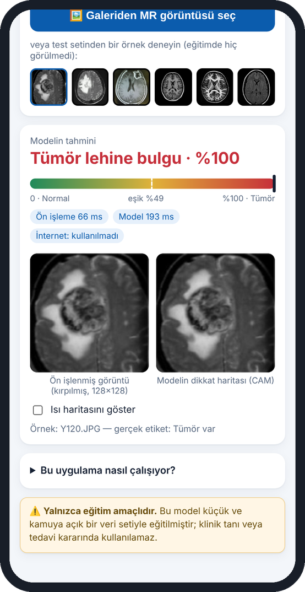
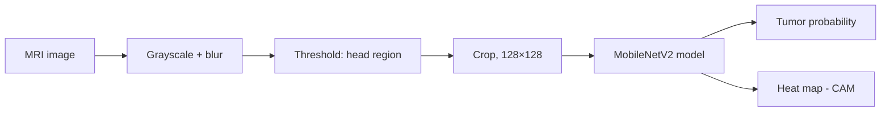
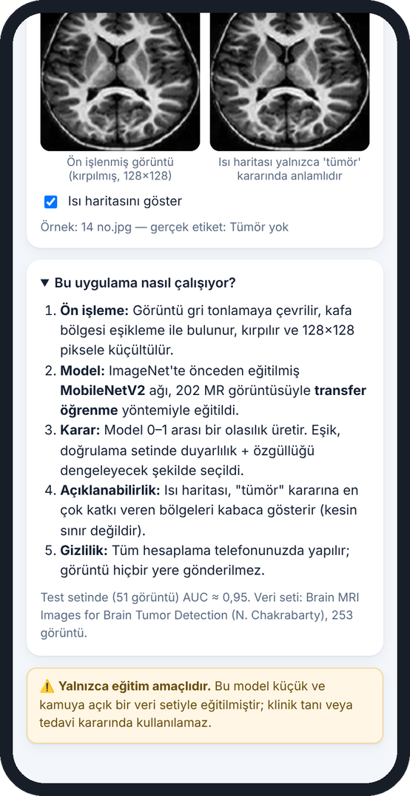

<p align="center"></p>
<h1 align="center">Beyin MR YZ</h1>
<p align="center"><i>Brain tumor detection on MRI slices</i></p>
<p align="center"><a href="README.md">Türkçe</a> · <b>English</b></p>
<p align="center">
  
  
  
</p>

An educational Android app that estimates the probability of a brain tumor on an axial MRI slice in about 0.1 seconds and shows, as a heat map, where the model looked when deciding. Everything runs on the phone. (*Beyin MR YZ* = "Brain MRI AI".)

<p align="center">&nbsp;&nbsp;</p>

> [!IMPORTANT]
> **For educational use only.** Not for clinical diagnosis or treatment decisions.

## At a glance

| Item | Value |
| --- | --- |
| Package name | tr.saglikyz.beyinmr |
| Version | 1.0 |
| Requires | Android 5.0 or later |
| Size | 1.7 MB |
| Internet permission | None — images never leave the device |
| Model | MobileNetV2 (ImageNet pre-trained), transfer learning |
| Training data | 168 training + 34 validation images |
| Test performance | AUC 0.95 · threshold 49% |

**Download:** [`BeyinMR_YZ.apk`](BeyinMR_YZ.apk)

## Contents

- [Installation](#installation)
- [Step by step](#step-by-step)
- [Reading the result card](#reading-the-result-card)
- [Heat map and a normal example](#heat-map-and-a-normal-example)
- [How the app works](#how-the-app-works)
- [For best results](#for-best-results)
- [Troubleshooting](#troubleshooting)
- [Teaching tips](#teaching-tips)
- [Data and model](#data-and-model)
- [For developers](#for-developers)

## Installation

The app is not on the Play Store; it is installed directly from the APK file. Android 5.0 or later is required.

1. Copy `BeyinMR_YZ.apk` to the phone (WhatsApp, e-mail, Google Drive or USB cable).
2. On the phone, tap the APK in the **Files** or **Downloads** folder.
3. If an "Install unknown apps" warning appears, tap **Settings**, turn on **Allow from this source** for the app you opened the file with (e.g. Files, Chrome), and go back.
4. Tap **Install**. If Play Protect warns about an "unrecognized developer", choose **More details → Install anyway**.
5. The app icon appears on the home screen or in the app list.

**To open it on a computer:** open `mobil/www/index.html` in Chrome or Edge; no installation or internet is needed. This is the easiest way to project the app during a lecture (for a phone-sized view press F12 → device toolbar).

> [!NOTE]
> The app interface is in Turkish. Button and label names below are given as they appear on screen, followed by an English translation.

## Step by step

1. Open the app. At the top is the **Galeriden MR görüntüsü seç** ("Select MRI image from gallery") button; below it are 6 sample images the model never saw during training (the first three with a tumor, the last three normal).
2. Tap a sample or pick your own image from the gallery (JPG/PNG; a screenshot also works). The page scrolls to the result card automatically.
3. Read the result card: the large text gives the decision and probability, and the colored bar shows where the probability sits relative to the threshold.

<p align="center">&nbsp;&nbsp;</p>
<p align="center"><sub>Figure 1. Left: start screen with sample images. Right: result and heat map for a tumor sample.</sub></p>

## Reading the result card

| On screen | Meaning |
| --- | --- |
| Tümör lehine bulgu · %99 ("Finding suggests tumor · 99%") | Probability above the threshold (49%); red text |
| Tümör saptanmadı · %7 ("No tumor detected · 7%") | Probability below the threshold; green text |
| Colored bar and black marker | Black marker = the model's probability; white dashed line = decision threshold |
| Ön işleme / Model (ms) | Time for preprocessing (finding and cropping the head) and for the model |
| İnternet: kullanılmadı ("Internet: not used") | The image did not leave the phone |
| Left small image | What the model actually sees: cropped, grayscale, 128×128 |
| Right small image | Heat map: red-yellow areas contributed most to the decision |

## Heat map and a normal example

Toggle **Isı haritasını göster** ("Show heat map") to compare with the underlying tissue. The heat map is drawn only for a "tumor" decision; for a normal result the right image is the plain slice.

<p align="center">&nbsp;&nbsp;</p>
<p align="center"><sub>Figure 2. Left: heat map switched off. Right: a normal example, "No tumor detected · 7%".</sub></p>

The heat map is a rough "attention" indicator, not a tumor boundary. If it concentrates on the skull edge or on text in the image, the model may be using a wrong cue — a good discussion point with students.

## How the app works

The **Bu uygulama nasıl çalışıyor?** ("How does this app work?") section at the bottom of the page describes these steps in five points.



<p align="center"></p>
<p align="center"><sub>Figure 3. The "How does this app work?" section expanded.</sub></p>

## For best results

- Use an axial slice; the model was not trained on coronal or sagittal slices.
- The image should have a dark background with the whole head in frame; photos of a screen with reflections degrade the result.
- Upload a single slice; a multi-slice PACS screenshot makes it unclear what the model receives.
- The training data mixes T1, T2 and FLAIR; results on DWI, CT or pediatric MRI are not reliable.

## Troubleshooting

| Problem | Fix |
| --- | --- |
| "App not installed" | An older version with the same package name is installed: uninstall it first, then install again. |
| "This type of file can harm your device" | This is the browser's download warning; choose **Download anyway**. The app requests no internet permission. |
| Play Protect warning during installation | **More details → Install anyway**. |
| The gallery button does not open a file picker | Check that a Files or Gallery app is installed; you can continue with the sample images. |
| Unexpected result | Check that the image is a single, axial slice with a dark background; the left small image shows what the model sees. |

## Teaching tips

Show a tumor sample first, then a normal one; then open a "where is the model looking?" discussion with a sample whose heat map drifts toward the edge.

## Data and model

| Approach (test set, 51 images) | AUC | Sensitivity | Specificity |
| --- | --- | --- | --- |
| Radiomics + logistic regression | 0.94 | 0.84 | 0.85 |
| Small CNN trained from scratch | 0.82 | 0.87 | 0.75 |
| **Transfer learning (MobileNetV2) — the model in the app** | **0.95** | **0.74** | **0.95** |

Dataset: N. Chakrabarty, *Brain MRI Images for Brain Tumor Detection* (Kaggle); 253 images (155 with tumor, 98 without). Near-duplicate images were grouped so that training and test sets do not overlap. Details: notebooks 1.1–1.4 (in Turkish).

## For developers

### Folder structure

```
01_Beyin_MR_Tumor/
├── 1_1_Goruntu_Nedir_ve_On_Isleme.ipynb
├── 1_2_Klasik_Makine_Ogrenmesi.ipynb
├── 1_3_Derin_Ogrenme_CNN_ve_Transfer.ipynb
├── 1_4_Aciklanabilirlik_ve_Mobil.ipynb   ← exports the model to mobil/www/model.js
├── beyin_on_isleme.py                     ← preprocessing (identical to the JS version)
├── yz_aktar.py                            ← Keras → JavaScript exporter
├── veri/  tumor_var/ (155)  tumor_yok/ (98)
├── onegitimli/                            ← MobileNetV2 ImageNet weights
├── model/                                 ← trained Keras models
├── mobil/
│   ├── www/  index.html · app.js · yzmotor.js · model.js · ornekler.js
│   ├── ikon.png
│   └── apk_derleme/                       ← APK build script
└── BeyinMR_YZ.apk
```

### Rebuilding the APK

The app is a very small Android WebView shell that displays the HTML + JavaScript in `mobil/www/`; Gradle and Android Studio are not needed. On Ubuntu/Debian:

```bash
sudo apt install android-sdk android-sdk-platform-23 openjdk-17-jdk
./mobil/apk_derleme/build_apk.sh mobil/www tr.saglikyz.beyinmr "Beyin MR YZ" "#083d75" mobil/ikon.png BeyinMR_YZ.apk
```

`mobil/apk_derleme/saglikyz.keystore` is a signing key created for teaching only (its password is written in the script). If you distribute the app, generate your own key: `keytool -genkeypair -keystore my.keystore -alias mine -keyalg RSA -keysize 2048 -validity 10000`.

### Retraining the model

The model files (`mobil/www/*model*.js`) are produced in the last section of the notebooks. Re-run the notebook from the top and repeat the build command above. The notebook also checks automatically that the JavaScript engine on the phone gives the same results as the Python model.

## License and attribution

The code and guide are shared for educational purposes. The datasets used are subject to their own licenses; cite the original source of each dataset in publications. Results from the app are not medical advice.
