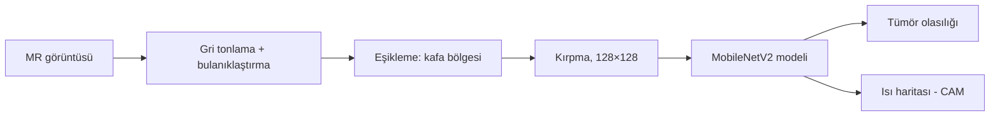

<p align="center"></p>
<h1 align="center">Beyin MR YZ</h1>
<p align="center"><i>Beyin MR kesitinde tümör tespiti</i></p>
<p align="center"><b>Türkçe</b> · <a href="README.en.md">English</a></p>
<p align="center">
  
  
  
</p>

Bir aksiyel beyin MR kesitinde tümör olasılığını yaklaşık 0,1 saniyede hesaplayan ve modelin karar verirken baktığı bölgeyi ısı haritasıyla gösteren, tamamen telefonda çalışan eğitim uygulaması.

<p align="center">&nbsp;&nbsp;</p>

> [!IMPORTANT]
> **Yalnızca eğitim amaçlıdır.** Klinik tanı veya tedavi kararında kullanılamaz.

## Özet

| Özellik | Değer |
| --- | --- |
| Paket adı | tr.saglikyz.beyinmr |
| Sürüm | 1.0 |
| Gereksinim | Android 5.0 ve üzeri |
| Boyut | 1,7 MB |
| İnternet izni | Yok — görüntü cihazdan çıkmaz |
| Model | MobileNetV2 (ImageNet ön eğitimli), transfer öğrenme |
| Eğitim verisi | 168 eğitim + 34 doğrulama görüntüsü |
| Test başarısı | AUC 0,95 · eşik %49 |

**İndir:** [`BeyinMR_YZ.apk`](BeyinMR_YZ.apk)

## İçindekiler

- [Kurulum](#kurulum)
- [Adım adım kullanım](#adım-adım-kullanım)
- [Sonuç kartını okumak](#sonuç-kartını-okumak)
- [Isı haritası ve normal örnek](#isı-haritası-ve-normal-örnek)
- [Uygulama nasıl çalışıyor?](#uygulama-nasıl-çalışıyor)
- [En iyi sonuç için](#en-iyi-sonuç-için)
- [Sorun giderme](#sorun-giderme)
- [Sunumda kullanım](#sunumda-kullanım)
- [Veri ve model](#veri-ve-model)
- [Geliştiriciler için](#geliştiriciler-için)

## Kurulum

Uygulama Play Store'da değildir; APK dosyasıyla doğrudan kurulur. Android 5.0 ve üzeri gerekir.

1. `BeyinMR_YZ.apk` dosyasını telefona aktarın (WhatsApp, e-posta, Google Drive veya USB kablo).
2. Telefonda **Dosyalar** veya **İndirilenler** klasöründen APK'ya dokunun.
3. "Bilinmeyen uygulamaları yükle" uyarısı çıkarsa **Ayarlar**'a dokunun, dosyayı açtığınız uygulama (ör. Dosyalar, Chrome) için **Bu kaynaktan izin ver**'i açın ve geri dönün.
4. **Yükle**'ye dokunun. Play Protect "tanınmayan geliştirici" uyarısı verirse **Ayrıntılar → Yine de yükle**'yi seçin.
5. Uygulama simgesi ana ekranda veya uygulama listesinde görünür.

**Bilgisayarda açmak için:** `mobil/www/index.html` dosyasını Chrome veya Edge ile açın; kurulum ve internet gerekmez. Sunumda projeksiyona yansıtmanın en kolay yolu budur (telefon görünümü için F12 → cihaz simgesi).

## Adım adım kullanım

1. Uygulamayı açın. Üstte **Galeriden MR görüntüsü seç** düğmesi, altında modelin eğitimde hiç görmediği 6 örnek görüntü vardır (ilk üçü tümörlü, son üçü normal).
2. Bir örneğe dokunun ya da galeriden kendi görüntünüzü seçin (JPG/PNG; ekran görüntüsü de olur). Sayfa kendiliğinden sonuç kartına kayar.
3. Sonuç kartını okuyun: büyük yazı kararı ve olasılığı, renkli çubuk olasılığın eşiğe göre yerini gösterir.

<p align="center">&nbsp;&nbsp;</p>
<p align="center"><sub>Şekil 1. Sol: açılış ekranı ve örnek görüntüler. Sağ: tümörlü bir örnekte sonuç ve ısı haritası.</sub></p>

## Sonuç kartını okumak

| Ekrandaki öğe | Anlamı |
| --- | --- |
| Tümör lehine bulgu · %99 | Olasılık eşiğin (%49) üzerinde; kırmızı yazı |
| Tümör saptanmadı · %7 | Olasılık eşiğin altında; yeşil yazı |
| Renkli çubuk ve siyah imleç | Siyah imleç = modelin olasılığı; beyaz kesikli çizgi = karar eşiği |
| Ön işleme / Model (ms) | Kafa bölgesini bulup kırpma ve modelin hesaplama süresi |
| İnternet: kullanılmadı | Görüntü telefondan çıkmadı |
| Sol küçük resim | Modelin gerçekte gördüğü görüntü: kırpılmış, gri, 128×128 |
| Sağ küçük resim | Isı haritası: kırmızı-sarı alanlar karara en çok katkı verenler |

## Isı haritası ve normal örnek

**Isı haritasını göster** kutusunu kapatıp açarak alttaki dokuyu karşılaştırabilirsiniz. Isı haritası yalnızca "tümör" kararında çizilir; normal sonuçta sağ resim düz görüntüdür.

<p align="center">&nbsp;&nbsp;</p>
<p align="center"><sub>Şekil 2. Sol: ısı haritası kapalı. Sağ: normal bir örnekte "Tümör saptanmadı · %7".</sub></p>

Isı haritası kaba bir "dikkat" göstergesidir, tümör sınırı değildir. Harita kafatası kenarında ya da görüntüdeki yazılarda yoğunlaşıyorsa model yanlış bir ipucu kullanıyor olabilir; bu, öğrencilerle tartışmak için iyi bir örnektir.

## Uygulama nasıl çalışıyor?

Sayfanın altındaki **Bu uygulama nasıl çalışıyor?** bölümü aşağıdaki adımları beş maddede anlatır.



<p align="center"></p>
<p align="center"><sub>Şekil 3. "Bu uygulama nasıl çalışıyor?" bölümü açıkken.</sub></p>

## En iyi sonuç için

- Aksiyel (yatay) kesit kullanın; model koronal/sagittal kesitle eğitilmedi.
- Görüntü koyu arka planlı ve kafanın tamamı kadrajda olmalı; ekrandan çekilmiş yansımalı fotoğraflar sonucu bozar.
- Tek bir kesit yükleyin; çok kesitli bir PACS ekran görüntüsü modele ne verdiğinizi belirsizleştirir.
- Eğitim verisi T1, T2 ve FLAIR karışıktır; DWI, BT veya çocuk MR'ında sonuç güvenilir değildir.

## Sorun giderme

| Sorun | Çözüm |
| --- | --- |
| "Uygulama yüklenmedi" | Aynı paket adıyla eski bir sürüm var: önce eskisini kaldırın, sonra tekrar yükleyin. |
| "Bu tür dosya cihazınıza zarar verebilir" | Tarayıcının indirme uyarısıdır; **Yine de indir** deyin. Uygulama internet izni istemez. |
| Kurulumda Play Protect uyarısı | **Ayrıntılar → Yine de yükle**. |
| Galeri düğmesi dosya seçiciyi açmıyor | Telefonda Dosyalar veya Galeri uygulamasının yüklü olduğunu kontrol edin; örnek görüntülerle devam edebilirsiniz. |
| Beklenmedik sonuç | Görüntünün aksiyel, tek kesit ve koyu arka planlı olduğunu kontrol edin; sol küçük resim modelin ne gördüğünü gösterir. |

## Sunumda kullanım

Önce tümörlü, sonra normal bir örnek gösterin; ardından ısı haritasının kenara kaydığı bir örnekle "model nereye bakıyor?" tartışması açın.

## Veri ve model

| Yaklaşım (test seti, 51 görüntü) | AUC | Duyarlılık | Özgüllük |
| --- | --- | --- | --- |
| Radyomiks + lojistik regresyon | 0,94 | 0,84 | 0,85 |
| Sıfırdan küçük CNN | 0,82 | 0,87 | 0,75 |
| **Transfer öğrenme (MobileNetV2) — uygulamadaki model** | **0,95** | **0,74** | **0,95** |

Veri seti: N. Chakrabarty, *Brain MRI Images for Brain Tumor Detection* (Kaggle); 253 görüntü (155 tümörlü, 98 tümörsüz). Neredeyse kopya görüntüler gruplanarak eğitim ve test birbirinden ayrıldı. Ayrıntılar: not defterleri 1.1–1.4.

## Geliştiriciler için

### Klasör yapısı

```
01_Beyin_MR_Tumor/
├── 1_1_Goruntu_Nedir_ve_On_Isleme.ipynb
├── 1_2_Klasik_Makine_Ogrenmesi.ipynb
├── 1_3_Derin_Ogrenme_CNN_ve_Transfer.ipynb
├── 1_4_Aciklanabilirlik_ve_Mobil.ipynb   ← modeli mobil/www/model.js'e aktarır
├── beyin_on_isleme.py                     ← ön işleme (JS ile birebir aynı)
├── yz_aktar.py                            ← Keras → JavaScript aktarıcı
├── veri/  tumor_var/ (155)  tumor_yok/ (98)
├── onegitimli/                            ← MobileNetV2 ImageNet ağırlıkları
├── model/                                 ← eğitilmiş Keras modelleri
├── mobil/
│   ├── www/  index.html · app.js · yzmotor.js · model.js · ornekler.js
│   ├── ikon.png
│   └── apk_derleme/                       ← APK derleme betiği
└── BeyinMR_YZ.apk
```

### APK'yı yeniden derlemek

Uygulama, `mobil/www/` içindeki HTML + JavaScript'i gösteren çok küçük bir Android WebView kabuğudur; Gradle veya Android Studio gerekmez. Ubuntu/Debian'da:

```bash
sudo apt install android-sdk android-sdk-platform-23 openjdk-17-jdk
./mobil/apk_derleme/build_apk.sh mobil/www tr.saglikyz.beyinmr "Beyin MR YZ" "#083d75" mobil/ikon.png BeyinMR_YZ.apk
```

`mobil/apk_derleme/saglikyz.keystore` yalnızca eğitim için oluşturulmuş bir imza anahtarıdır (parolası betikte yazılıdır). Uygulamayı dağıtacaksanız kendi anahtarınızı üretin: `keytool -genkeypair -keystore benim.keystore -alias benim -keyalg RSA -keysize 2048 -validity 10000`.

### Modeli yeniden eğitmek

Model dosyaları (`mobil/www/*model*.js`) not defterlerinin son bölümünde üretilir. Not defterini baştan çalıştırıp yukarıdaki derleme komutunu tekrarlamak yeterlidir. Not defteri, telefondaki JavaScript motorunun Python modeliyle aynı sonucu verdiğini de otomatik olarak doğrular.

## Lisans ve atıf

Kod ve kılavuz eğitim amacıyla paylaşılmıştır. Kullanılan veri setleri kendi lisanslarına tabidir; yayınlarda veri setinin özgün kaynağına atıf yapın. Uygulamanın verdiği sonuçlar tıbbi tavsiye değildir.
